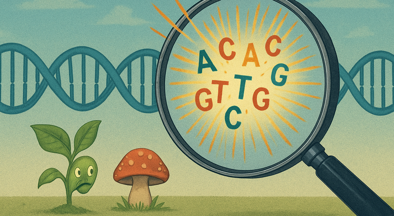
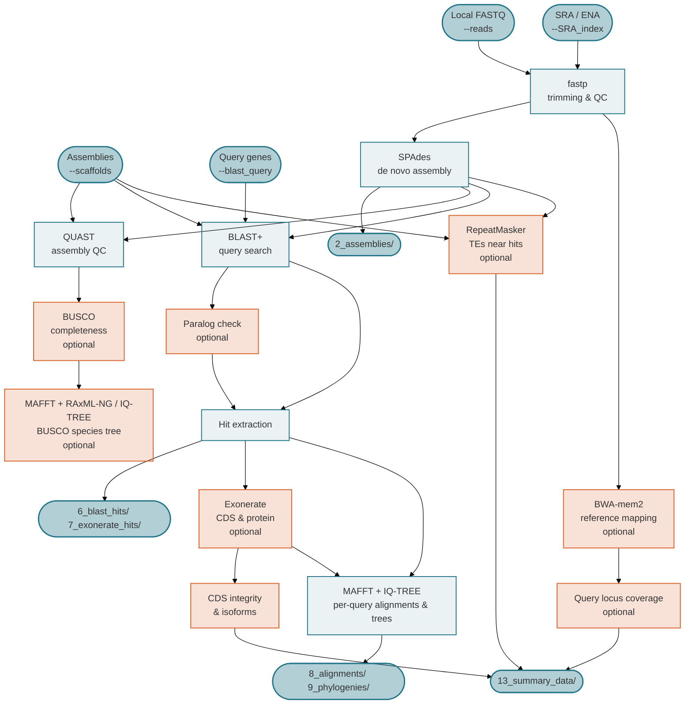

{ .gd-logo }

**genomedenovo_nf** is a [Nextflow](https://www.nextflow.io/) pipeline that assembles Illumina genomes de novo (or takes existing assemblies), checks assembly quality, and searches every genome for one or more query genes. For each query it extracts the hits, aligns them and builds trees and, optionally, recovers the exact coding sequences, classifies them as intact or truncated, and groups them into isoforms. It accepts paired-end reads from local files, NCBI/ENA SRA accessions, or pre-assembled scaffolds, in any combination.

Optional modules add a BUSCO species tree, a paralog check of the hits, read coverage at the query locus of a reference genome, and the transposable elements next to each hit. Please report any issues or share feature requests on the [GitHub Issues](https://github.com/crolllab/genomedenovo_nf/issues) page.

The pipeline is designed to run both on HPC clusters via SLURM or on single machines, and uses [Singularity](https://sylabs.io/singularity/) containers so all software dependencies are reproducible and portable. Every sample is assembled and searched independently, so large panels of genomes are processed in parallel.

[Get started :octicons-rocket-16:](getting-started.md){ .md-button .md-button--primary }
[View on GitHub :octicons-mark-github-16:](https://github.com/crolllab/genomedenovo_nf){ .md-button }
<!-- Add the Zenodo DOI badge once the first release has been archived (see RELEASE.md):

-->

---

## Pipeline Summary

The pipeline accepts three input modes, which can be combined in one run and converge at the assembly QC step:

1. **Local FASTQ files** (`--reads`): paired-end Illumina reads are trimmed with fastp and assembled per sample with SPAdes.
2. **SRA/ENA accessions** (`--SRA_index`): accessions are resolved to runs and downloaded from ENA, with NCBI `sra-tools` as fallback; paired-end and single-end runs are handled automatically before joining the same trimming and assembly path.
3. **Existing assemblies** (`--scaffolds`): FASTA assemblies skip trimming and assembly.

Every assembly is checked with QUAST and, with `--busco_lineage`, BUSCO, whose single-copy genes can be turned into a species tree (`--phylo_tree`). Each query gene (`--blast_query`) is searched with BLAST in every assembly; the best hit locus per sample is extracted with flanking sequence, aligned with MAFFT, and placed in an IQ-TREE tree. With `--search_tool exonerate`, Exonerate recovers the exact CDS and protein of each hit, which are checked codon by codon for truncations and grouped into numbered isoforms with their own trees. `--query_paralog` keeps hits on known paralogs out of all of these, `--reference_genome` with `--locus_coverage` checks the read depth at the query locus of a reference genome, and `--repeat_library` reports the transposable elements next to each hit.

---

## Key features

-   :material-dna: **Flexible input**

    ---

    Local FASTQ, SRA/ENA accessions, or existing assemblies — all in the same run.

-   :material-magnify: **Query gene search**

    ---

    BLAST hits, exact Exonerate CDS and protein, intact/truncated calls and frequency-numbered isoforms for every query.

-   :material-source-branch: **Trees and paralogs**

    ---

    Per-query and isoform trees, a BUSCO species tree, and a paralog check that keeps paralog hits out of all outputs.

-   :material-server: **HPC-ready**

    ---

    SLURM profile with resources matched to each tool, capped by `--max_cpus`, `--max_memory` and `--max_time`.

-   :material-package-variant-closed: **Fully containerised**

    ---

    All tools run inside Singularity images pulled automatically from BioContainers (quay.io) and Docker Hub.

-   :material-table: **Summary tables**

    ---

    One table per query and topic: hits, CDS integrity, mutations, isoforms, paralogs, TEs near hits and locus coverage.

---

## Software used by genomedenovo_nf

Please cite the underlying tools if you use them through this pipeline.

| Tool | Version | Role | Reference |
|------|---------|------|-----------|
| [entrez-direct](https://www.ncbi.nlm.nih.gov/books/NBK179288/) | 24.0 | NCBI SRA accession resolution | NCBI |
| [sra-tools](https://github.com/ncbi/sra-tools) | 3.2.1 | NCBI SRA data download (fallback to ENA) | NCBI |
| [fastp](https://github.com/OpenGene/fastp) | 1.3.1 | Adapter trimming, read QC | Chen et al. 2018, *Bioinformatics* [doi:10.1093/bioinformatics/bty560](https://doi.org/10.1093/bioinformatics/bty560) |
| [SPAdes](https://github.com/ablab/spades) | 4.2.0 | De novo assembly | Prjibelski et al. 2020, *Curr. Protoc. Bioinformatics* [doi:10.1002/cpbi.102](https://doi.org/10.1002/cpbi.102) |
| [QUAST](https://github.com/ablab/quast) | 5.3.0 | Assembly QC | Gurevich et al. 2013, *Bioinformatics* [doi:10.1093/bioinformatics/btt086](https://doi.org/10.1093/bioinformatics/btt086) |
| [BUSCO](https://busco.ezlab.org/) | 6.0.0 | Genome completeness, single-copy genes for the species tree | Manni et al. 2021, *Mol. Biol. Evol.* [doi:10.1093/molbev/msab199](https://doi.org/10.1093/molbev/msab199) |
| [BLAST+](https://blast.ncbi.nlm.nih.gov/) | 2.17.0 | Query, paralog and reference locus search | Camacho et al. 2009, *BMC Bioinformatics* [doi:10.1186/1471-2105-10-421](https://doi.org/10.1186/1471-2105-10-421) |
| [Exonerate](https://github.com/nathanweeks/exonerate) | 2.4.0 | Spliced alignment, CDS and protein | Slater & Birney 2005, *BMC Bioinformatics* [doi:10.1186/1471-2105-6-31](https://doi.org/10.1186/1471-2105-6-31) |
| [MAFFT](https://mafft.cbrc.jp/alignment/software/) | 7.525 | Multiple sequence alignment | Katoh & Standley 2013, *Mol. Biol. Evol.* [doi:10.1093/molbev/mst010](https://doi.org/10.1093/molbev/mst010) |
| [IQ-TREE](https://iqtree.github.io/) | 3.1.2 | Per-query, isoform and (optionally) BUSCO trees | Minh et al. 2020, *Mol. Biol. Evol.* [doi:10.1093/molbev/msaa015](https://doi.org/10.1093/molbev/msaa015) |
| [RAxML-NG](https://github.com/amkozlov/raxml-ng) | 2.0.2 | BUSCO species tree | Kozlov et al. 2019, *Bioinformatics* [doi:10.1093/bioinformatics/btz305](https://doi.org/10.1093/bioinformatics/btz305) |
| [ape](https://emmanuelparadis.github.io/) (R) | ggtree 4.0.4 image | Isoform tree plots | Paradis & Schliep 2019, *Bioinformatics* [doi:10.1093/bioinformatics/bty633](https://doi.org/10.1093/bioinformatics/bty633) |
| [RepeatMasker](https://www.repeatmasker.org/) | 4.2.3 | TE annotation | Smit, Hubley & Green, RepeatMasker Open-4.0 |
| [bwa-mem2](https://github.com/bwa-mem2/bwa-mem2) | 2.3 | Reference read mapping | Vasimuddin et al. 2019, *IPDPS* [doi:10.1109/IPDPS.2019.00041](https://doi.org/10.1109/IPDPS.2019.00041) |
| [SAMtools](https://www.htslib.org/) | 1.23.1 | BAM sorting, depth, sequence extraction | Danecek et al. 2021, *GigaScience* [doi:10.1093/gigascience/giab008](https://doi.org/10.1093/gigascience/giab008) |
| [R / tidyverse](https://www.tidyverse.org/) | 4.4.3 | fastp and mapping summary tables | R Core Team; Wickham et al. 2019, *JOSS* [doi:10.21105/joss.01686](https://doi.org/10.21105/joss.01686) |

---

## Release notes

### v1.0.0 *(October 2026)*

- First stable release, archived on Zenodo; documentation moved to this site.
- Coverage conflict flag (`--locus_coverage`): samples whose assembly lacks the query but whose reads cover its reference locus are flagged.
- Paralog hits are kept out of all downstream outputs (`--query_paralog`), including neighbouring paralog copies in the hit flanks and paralog loci on the reference.
- Proteins are translated in the correct frame when Exonerate starts mid-codon; a lone non-canonical splice site no longer makes a model truncated.
- Task resources matched to what each tool uses, capped by `--max_cpus`, `--max_memory` and `--max_time`; runs under Nextflow 26.

### v0.9.1 *(October 2026)*

- Paralog check (`--query_paralog`), alignment filter for the per-query trees (`--min_align_prop`) and `--exonerate_refine`.
- CDS integrity classification (full-length, truncated, stop-lost, partial at contig edges) with per-mutation tables, isoform sequences and isoform trees; isoforms numbered by frequency.
- TEs near each hit (`--repeat_library` with `--blast_query`), `sample_names.tsv` and a sample name collision check before assembly.
- Fixes to Exonerate CDS recovery (nucleotide queries, divergent alleles, antisense models), `blastn` sensitivity, sample names with special characters and `--NCBI_API_key`.

### v0.9.0 *(September 2026)*

- First tagged pre-release: local FASTQ, SRA or scaffold input; fastp, SPAdes, QUAST and BUSCO; BLAST and Exonerate query search with MAFFT alignments and isoform IDs.

---

## Questions and feature requests

Questions, bug reports and feature requests are welcome on the [GitHub Issues](https://github.com/crolllab/genomedenovo_nf/issues) page.

!!! question "Questions? Found a bug? Feature requests?"
    Go to the [GitHub Issues](https://github.com/crolllab/genomedenovo_nf/issues) page

---

## How to cite

If you use genomedenovo_nf in your research, please cite:

> Croll, D. (2026). _genomedenovo_nf_ - a Nextflow pipeline for de novo genome assembly and BLAST-based querying (v1.0.0). [https://github.com/crolllab/genomedenovo_nf](https://github.com/crolllab/genomedenovo_nf)

<!-- Replace the GitHub link with the Zenodo DOI and add its badge once the first release has been archived (see RELEASE.md). -->

Please also cite the underlying tools listed in the [Software table](#software-used-by-genomedenovo_nf) above.
